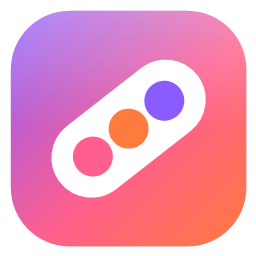
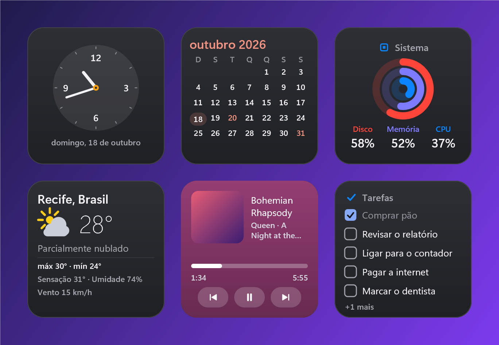

<p align="center"></p>

<h1 align="center">Pod</h1>

<p align="center">
  Widgets nativos para a área de trabalho do Windows, escritos em Rust.<br>
  Cartões e notas atrás dos seus aplicativos, que voltam como estavam depois de reiniciar.
</p>

<p align="center">
  
  
  
  
  
</p>

> Finally, a name that actually tells you what it is.

<p align="center"></p>

<p align="center"><sub>Cartões reais do motor, renderizados offscreen com dados de demonstração (<code>Pod.exe --gallery</code>). Também há o <a href="docs/screenshots/widgets-light.png">tema claro</a>.</sub></p>

## Destaques

- **Camada de área de trabalho.** Os cartões ficam sempre atrás dos aplicativos e não roubam o foco ao clicar; arrastam e encaixam numa grade, e redimensionam pelas bordas.
- **Quase 40 widgets.** Relógio, calendário, sistema (anéis concêntricos), música, clima, timers, lembretes e mais, além de notas de texto.
- **Visual estilo macOS.** Material liso, cantos arredondados, tema claro/escuro/alto contraste, capa de música tingindo o cartão e vidro translúcido opcional.
- **Modo de edição.** Galeria na base da tela (por categoria; clique ou arraste), selos "−" para remover, espaços "+" tracejados para escolher o lugar e "Restaurar padrão" com confirmação.
- **Menu da bandeja próprio.** Cantos arredondados, ícones e submenus; em **Ajustes**: iniciar com o Windows, modo desempenho, vidro e widgets de internet.
- **Leve por padrão.** Esconde os cartões sob apps em tela cheia (modo desempenho) e só pede o que o widget precisa.
- **Persistência segura.** Gravação atômica com geração anterior, recuperação automática e arquivo preservado em `recovery`.
- **Privado.** Sem conta, sem telemetria. Widgets de internet (Clima, Notícias, GitHub, Bolsa) ficam **desligados** até você ligar.

## Instalação

Baixe o `Pod.exe` (portátil, é só abrir) ou o ZIP com instalador na página de [Releases](../../releases/latest).

```powershell
# ZIP: extraia e, no PowerShell da pasta extraída:
powershell -ExecutionPolicy Bypass -File .\install.ps1 -Launch
```

Instala para o seu usuário (sem administrador) em `%LOCALAPPDATA%\Programs\Pod`, cria o atalho no Menu Iniciar e **não** inicia com o Windows (use `-Autostart`, ou ligue em Ajustes no menu da bandeja). Atualizar: `install.ps1 -CloseRunning`. Desinstalar: `uninstall.ps1` (preserva seus dados; `-RemoveData` apaga). Sem instalar: `Pod.exe --data-dir "D:\MeusDadosDoPod"`.

**Requisitos:** Windows 11, 64 bits. O pacote **não é assinado**: o SmartScreen pode avisar ("Mais informações" → "Executar assim mesmo"); confira o hash em `SHA256SUMS.txt`.

> **Leia antes de usar:** esta V1 **não foi validada para acessibilidade** (Narrator e outros leitores de tela, foco de teclado nos cartões, IME) e foi testada só em Windows 11, numa máquina de desenvolvimento. Veja [Limitações](#limitações-conhecidas).

## Compilar

Requer a toolchain **MSVC** (fixada em `rust-toolchain.toml`) e o Windows SDK (o `rc.exe` compila ícone e manifesto).

```powershell
cargo run                                   # abre os cartões com ícone na bandeja
cargo build --release                       # binário otimizado
cargo test                                  # suíte completa (app e modelo)

powershell -ExecutionPolicy Bypass -File tools\package.ps1   # testes + release determinística + ZIP em dist\
```

Flags: `--data-dir <pasta>` (dados isolados) e `--gallery <pasta>` (renderiza cada widget × tamanho × tema em PNG, usado como regressão visual). Os modos de prova e diagnóstico (`--shadow-*`, `--focus-card`) só existem em builds de **debug**.

Os scripts `tools/verify-*.ps1` rodam o app real com dados isolados e **movem o cursor e enviam teclas de verdade**: não os rode com a sua tela em uso.

## Catálogo

| Categoria | Widgets |
| --- | --- |
| Tempo | Relógio, Progresso do tempo, Calendário, Contagem regressiva, Timer, Cronômetro, Pomodoro, Hora no mundo, Feriados |
| Produtividade | Lembretes, Hábitos, Agenda, Atalhos, Favoritos, Encomendas, Conversor, Água |
| Sistema | Sistema (anéis), Processador, Memória, Disco, Bateria, Rede, Música, Notificações, Uso do Claude, Área de transferência |
| Arquivos | Downloads, Capturas de tela |
| Internet (opt-in) | Clima, Notícias, GitHub, Bolsa |

Mais as **notas** de texto simples. Cada widget tem formatos de 1×1 a 4×4, conforme o tipo.

## Estrutura do repositório

| Pasta | Conteúdo |
| --- | --- |
| `crates/pod-model/` | Modelo puro e testável: View/Node/Kind, layout, grade, formas, esquema de persistência, serviços (clima, notícias, GitHub, mídia...) |
| `crates/pod-app/` | O app Windows: host Win32, render Direct2D, runtime de widgets, bandeja, menu, galeria de edição |
| `assets/` | Ícone e marca |
| `docs/` | Arquitetura, direção visual, ADRs e relatórios de validação |
| `tools/` | Empacotamento, instalador, verificações no app real e geração das imagens |
| `.github/workflows/` | CI |

### Módulos de `crates/pod-app/src/`

| Módulo | Papel |
| --- | --- |
| `main.rs`, `host.rs`, `shell.rs` | Ponto de entrada, janelas dos cartões e notas (camada de desktop) e o orquestrador (instâncias, monitores, edição) |
| `render.rs`, `gfx.rs`, `icons.rs`, `text.rs` | Desenho Direct2D/DirectWrite/DirectComposition, ícones vetoriais e texto |
| `ui/` | Tema, animação, modo de teclado e notas |
| `widgets/` | Um arquivo por widget |
| `runtime/` | Ciclo de vida, prazos e comandos dos widgets |
| `storage/` | Persistência atômica, recuperação e preferências |
| `tray.rs`, `menu.rs`, `autostart.rs` | Ícone da bandeja, menu próprio e iniciar com o Windows |
| `dock.rs`, `slot.rs`, `edit.rs`, `gallery.rs` | Galeria da base, espaços "+", Pod Studio (vitrine) e galeria offscreen |
| `a11y.rs`, `monitors.rs` | UI Automation e topologia de monitores/DPI |

## Documentação

| Assunto | Documento |
| --- | --- |
| Índice | [docs/README.md](docs/README.md) |
| Arquitetura (baseline histórico) | [docs/ARCHITECTURE.md](docs/ARCHITECTURE.md) |
| Direção visual | [docs/DESIGN.md](docs/DESIGN.md) |
| Decisões (ADRs) | [docs/decisions/](docs/decisions/) |
| Vidro e sombra ampla (estudo) | [ADR-0005](docs/decisions/0005-glass-default-and-wide-shadow.md) |
| Validações e limites de cada marco | [docs/validation/](docs/validation/) |
| Notas de verificação da V1 | [docs/validation/v1-release.md](docs/validation/v1-release.md) |

## Releases

- **Local:** `tools\package.ps1` roda os testes, compila com `--locked` (CRT estática, `/Brepro`) e monta `dist\Pod-X.Y.Z-win-x64.zip` com `Pod.exe`, instalador/desinstalador, licenças de terceiros e checksums. `tools\verify-package.ps1` instala, abre com dados novos, atualiza e desinstala em pastas de teste.
- **Publicar:** crie a tag `vX.Y.Z` e anexe o `Pod.exe`, o ZIP e o `.sha256` à release.
- **CI:** testes e build de release a cada push e pull request.

## Limitações conhecidas

- **Acessibilidade não validada:** Narrator e outros leitores de tela, IME e foco de teclado nos cartões (não há como pôr o foco do teclado num cartão; os botões respondem ao UI Automation `Invoke`).
- Testado só em Windows 11 na máquina de desenvolvimento: **não** em Windows 10, **não** em máquina virtual limpa, **não** com monitores de escalas (DPI) diferentes.
- Pacote **não assinado**; instalador em PowerShell, não MSI.
- Emoji restaurado de uma nota pode aparecer como caixa; vidro não desfoca o fundo; a sombra dos cartões é a curta do Windows (a sombra ampla foi estudada e **não** entrou).
- Fora da V1: chat de IA, cenas/mascote e atualização automática.

Histórico de versões em [CHANGELOG.md](CHANGELOG.md).

## Licença

[MIT](LICENSE). Licenças de terceiros: `THIRD-PARTY-LICENSES.txt` no pacote (gerado por `tools/third-party.ps1`).
