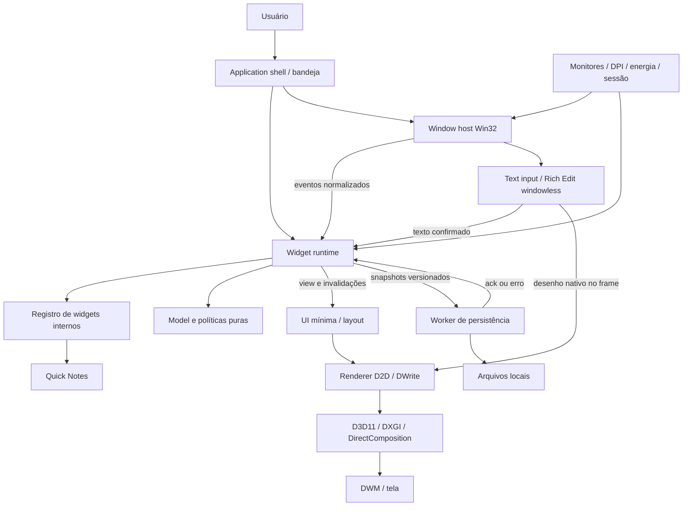

# POD — Documento de arquitetura

> Finally, a name that actually tells you what it is.

**Status:** proposta arquitetural para implementação incremental.  
**Escopo:** aplicativo desktop Windows nativo, em Rust.  
**Entrega atual:** decisões, contratos conceituais e critérios de implementação; nenhum código de aplicação.  
**Referência temporal:** 17 de outubro de 2026.

**Nota de evolução (20/10/2026):** este texto preserva o baseline de planejamento. O repositório já contém implementação; decisões posteriores estão em `docs/decisions/` e relatos de testes em `docs/validation/`. A [direção visual](DESIGN.md) detalha a linguagem do produto e o refinamento proposto para Quick Notes, sem declarar essa nova direção implementada.

As escolhas abaixo são recomendações de projeto. Referências à documentação oficial sustentam capacidades e restrições das APIs; elas não representam medições do Pod. Metas de desempenho precisam ser verificadas no protótipo.

## 1. Product definition

Pod é uma plataforma local de widgets independentes sobre o ambiente Windows. Cada instância tem conteúdo, configuração, posição, dimensões e visibilidade próprios. O usuário organiza pequenas ferramentas persistentes sem precisar manter uma janela central aberta.

A identidade visual deve transmitir calma e precisão: tipografia legível, espaçamento consistente, superfícies discretas, cantos arredondados, feedback imediato e animações curtas. Transparência é um recurso visual opcional; nunca deve comprometer leitura ou edição.

O primeiro produto entregue é pequeno: Quick Notes com múltiplas notas, edição de texto simples, movimentação, redimensionamento, exclusão, ocultação e restauração após reinício. Uma nota corresponde a uma instância de widget. Não existe um gerenciador de documentos escondido dentro do widget.

O Pod funciona na sessão interativa do usuário, sem serviço Windows, privilégios administrativos ou conexão de rede obrigatória. Fecha pela bandeja; ocultar uma nota não encerra o processo nem apaga conteúdo.

**Compatibilidade inicial:** Windows 11 como plataforma principal de validação; Windows 10 22H2 como baseline de compatibilidade técnica. Compatibilidade do Pod não altera o ciclo de suporte do sistema operacional. Primeira distribuição x64; ARM64 vem após validação nativa específica.

**Contrato sobre “parte do desktop”:** o MVP oferece widgets sem moldura tradicional, fora do Alt+Tab e da barra de tarefas, com posição persistente e comportamento discreto. Não promete substituir o shell nem ficar permanentemente entre o wallpaper e todas as janelas do Windows. Essa distinção é uma decisão de produto, explicada na seção 5.

Não pertencem ao MVP: loja, contas, sincronização, cloud, IA, plugins externos, RSS, previsão do tempo, calendário, música, editor rico ou SDK público. Duplicação e layouts nomeados são extensões posteriores; o layout atual já é salvo automaticamente.

## 2. Architecture

### Decisão geral

Um **monólito modular em um processo**, com **uma janela Win32 por widget**, uma thread principal dona da UI e dos recursos gráficos, e um worker dedicado à persistência. Os widgets internos são módulos Rust compilados no aplicativo.

Adotar inicialmente um workspace com dois crates:

- `pod-model`: tipos, regras e contratos de widgets independentes de Windows.
- `pod-app`: executável, runtime, widgets internos e adaptadores Windows.

Essa separação impõe uma fronteira útil: regras de estado e posicionamento podem ser testadas sem HWND, COM ou GPU. Separar renderer, armazenamento e janelas em crates agora só aumentaria a superfície pública; inicialmente são módulos privados do executável.

### Responsabilidades e propriedade

| Componente | Responsabilidade | Não deve conhecer |
| --- | --- | --- |
| Model | IDs, geometria lógica, envelopes persistentes e políticas puras | Win32, DirectX, filesystem |
| Runtime | Registro, instâncias, lifecycle, eventos, efeitos e agendamento | Detalhes de HWND e swap chain |
| Window host | Criar/destruir HWND, foco, movimento, resize, tradução de mensagens | Conteúdo semântico das notas |
| Renderer | Recursos D3D/D2D, texto estático, desenho e composição | Disco e lógica de notas |
| UI | Superfícies, controles mínimos, layout local e semântica acessível | Formato do arquivo persistente |
| Text input | Edição nativa, seleção, IME, caret e notificações de texto | Gerenciamento de layouts globais |
| Persistence | Validar, migrar, gravar e recuperar snapshots | HWND, recursos gráficos |
| Platform | Monitores, sessão, energia, bandeja e integração com shell | Estado interno de cada widget |
| Shell | Inicialização, composição de dependências, comandos e encerramento | Implementação detalhada de widgets |
| Widget | Estado e comportamento específicos de uma ferramenta | APIs Windows diretas, caminhos e handles |

O runtime é dono das instâncias e do estado durável em memória. O window host é dono dos HWNDs. O renderer é dono dos objetos gráficos. O armazenamento recebe cópias imutáveis de snapshots e é o único escritor no disco.

Configuration é uma responsabilidade explícita, mas pequena: preferências globais e configurações de cada instância são validadas e persistidas pelo mesmo mecanismo de snapshots. Não precisa de um serviço separado.

Não existe IPC no MVP: segunda execução detecta a instância existente, informa o usuário e sai. Não abre os arquivos para escrita. Um canal de ativação só será introduzido quando houver uma necessidade concreta.

### Dependências e regras

1. `pod-model` não depende de `pod-app`.
2. Widgets dependem de contratos e serviços estreitos; não de adaptadores concretos.
3. Somente o shell instancia e conecta os adaptadores.
4. Eventos são enums tipados; efeitos têm destinatário e resultado explícitos.
5. Nenhum singleton de estado mutável, service locator, barramento global ou grafo de callbacks entre widgets.
6. `unsafe` fica nas fronteiras FFI, com invariantes de ponteiros, lifetime, thread e ownership documentadas.

Em termos próximos de C#: um trait define comportamento compartilhado, mas não implica uma hierarquia de classes. Enums com dados tornam os casos de evento explícitos. `Drop` e ownership substituem grande parte da gestão manual equivalente a `IDisposable`; não há coletor de lixo para corrigir ciclos de ownership. Preferir um dono claro e IDs a referências fortes recíprocas.

## 3. Component diagram



As setas descrevem colaboração, não autorização irrestrita de importação. O shell passa dados e efeitos entre runtime e adaptadores; o widget não recebe o renderer nem o storage concretos.

## 4. Data flow

### Inicialização

1. Configurar logging sem conteúdo de notas e adquirir exclusividade por usuário/sessão.
2. Inicializar COM na thread de UI, DPI awareness via manifesto e uma janela top-level oculta de controle.
3. Ler e validar o snapshot no worker. Na primeira execução, iniciar vazio.
4. Enumerar monitores, resolver posições e preparar o dispositivo gráfico.
5. Migrar e criar cada instância pelo registro de tipos.
6. Criar HWNDs ocultos, superfícies e recursos de input.
7. Executar layout e primeiro desenho; só então mostrar as janelas elegíveis, sem roubar foco.
8. Reconstruir a bandeja e entrar no processamento normal de mensagens.

Se o armazenamento falhar, não inicializar silenciosamente um workspace vazio sobre dados existentes. Exibir uma recuperação explícita e preservar os arquivos originais.

### Criar, editar e salvar

O comando “Nova nota” cria um ID novo, estado vazio e posição inicial na área útil do monitor escolhido. O runtime registra a instância antes de solicitar sua janela. Se a criação falhar, a nota continua recuperável; o shell apresenta o erro.

Durante a edição, o mecanismo de texto nativo mantém seleção e composição transitórias. Uma notificação de alteração copia o texto confirmado para o estado da instância e incrementa sua revisão. Composição IME em andamento não é interpretada como comandos do aplicativo nem como uma série de caracteres finais.

O runtime marca estado e view como alterados. A UI invalida somente a janela afetada. O autosave agenda um snapshot após 500 ms sem alterações e, sob digitação contínua, no máximo a cada 2 s. O worker confirma a revisão efetivamente gravada; “salvo” só aparece após essa confirmação.

O limite de 2 s refere-se à solicitação de gravação em condições normais. Falhas, disco lento ou energia interrompida podem ampliá-lo. O aplicativo nunca transforma essa janela em promessa de perda zero.

### Mover e redimensionar

O window host usa o loop nativo de movimento/resize. Eventos atualizam a geometria efetiva em memória; o renderer acompanha o tamanho. Ao terminar a interação, o runtime transforma a geometria para coordenadas lógicas do monitor, atualiza a posição preferida e solicita persistência. Não gravar a cada pixel movido.

### Remover e ocultar

Ocultar atualiza a preferência durável de visibilidade, preservando a instância. “Ocultar todos temporariamente” é um estado transitório, distinto dessa preferência.

Excluir uma nota com conteúdo exige confirmação local. O runtime prepara um snapshot sem a instância, mas só finaliza a exclusão e destrói seus recursos depois da confirmação de gravação. Em caso de falha, a nota permanece acessível. Isso evita uma exclusão aparentemente bem-sucedida que reaparece no reinício.

### Encerrar

Suspender novos comandos, finalizar/cancelar composição de input de maneira nativa, obter o texto confirmado, solicitar o snapshot mais recente e processar o ack sem bloquear o message pump. Depois liberar editor, alvos gráficos, HWNDs e dispositivo, nessa ordem de dependência. Em falha de gravação durante encerramento solicitado pelo usuário, oferecer tentar novamente ou sair reconhecendo alterações pendentes.

No encerramento imposto pelo Windows, fazer tentativa limitada dentro do tempo disponível; nunca presumir que haverá tempo para salvar. O autosave é o mecanismo principal de proteção.

## 5. Window strategy

### Escolha: uma janela por widget

| Alternativa | Benefício | Custo decisivo | Decisão |
| --- | --- | --- | --- |
| HWND por widget | Foco, resize, movimento e DPI individuais | Mais superfícies e recursos de janela | Adotar |
| Um host cobrindo todo o desktop | Uma árvore visual central | Captura de input em áreas vazias, monitores e z-order artificiais | Rejeitar |
| Um host por monitor | Reduz o número de HWNDs | Mover entre monitores, foco e sobreposição ficam sob responsabilidade do Pod | Rejeitar inicialmente |
| Vários hosts com grupos de widgets | Pode otimizar centenas de elementos | Dois modelos de interação antes de existir necessidade | Reavaliar por medição |

Os dispositivos gráficos são compartilhados; uma janela não implica um dispositivo D3D nem uma thread próprios. O orçamento de GPU cresce principalmente com a área das superfícies e a frequência de atualização.

Usar janelas top-level `WS_POPUP`, sem caption tradicional, com `WS_EX_TOOLWINDOW` e, para o caminho de composição, `WS_EX_NOREDIRECTIONBITMAP`. Manter estilos necessários para o comportamento de resize, removendo a moldura visível através do tratamento não cliente. Não usar um owner invisível comum para os widgets: relações de ownership impõem regras de z-order e podem interferir em desktops virtuais.

Não aplicar `WS_EX_NOACTIVATE` permanentemente a widgets editáveis: edição precisa de foco e acessibilidade. Mostrar/restaurar com operação sem ativação; ativar quando o usuário clicar no conteúdo editável. Arrastar pela área reservada e redimensionar pelas bordas não deve iniciar edição. Tool windows ficam fora do Alt+Tab e da barra de tarefas conforme o modelo de estilos do Windows. [Extended Window Styles](https://learn.microsoft.com/en-us/windows/win32/winmsg/extended-window-styles)

### Política de camadas

No MVP há um modo **discreto**, não topmost: criação e restauração não levantam o widget sobre o aplicativo ativo; ao sair da edição, o host o reposiciona para trás das janelas normais usando operações documentadas, sem ativar. Não manter um loop que disputa z-order com outros processos.

`HWND_BOTTOM` posiciona uma janela no fundo da ordem; não cria uma camada contratual “acima dos ícones, abaixo de todos os aplicativos”. Ativar uma janela também pode elevá-la. Portanto, esse modo oferece comportamento discreto, mas não garante integração permanente com a superfície do Explorer. Win+D segue o comportamento do Windows; o Pod não desfaz a ação do usuário automaticamente. A bandeja permite mostrar novamente. [SetWindowPos](https://learn.microsoft.com/en-us/windows/win32/api/winuser/nf-winuser-setwindowpos)

Não usar mensagens privadas do Explorer, parenting em `WorkerW`/`Progman`, interfaces COM privadas ou hooks injetados. Se permanecer sempre visível acima do wallpaper, inclusive após Win+D, for requisito indispensável, essa parte da experiência exige uma investigação separada e possível revisão do escopo antes de prometer a funcionalidade. Não esconder esse risco atrás de uma abstração chamada “desktop layer”.

Após o MVP, adicionar modo “Sempre acima” por instância, opt-in, usando `HWND_TOPMOST`, com suspensão automática em fullscreen. Não faz parte do primeiro release mínimo.

### Input, bordas e transparência

O host processa `WM_NCHITTEST`: bordas e cantos retornam regiões de resize; a faixa de movimentação retorna caption; o conteúdo retorna client. Limites mínimos vêm da descrição do widget e são aplicados em `WM_GETMINMAXINFO`. Não prometer Snap Layouts do Windows 11 para um popup sem caption; snapping próprio entre widgets fica para depois.

Transparência visual por alpha não significa passagem de mouse. No caminho DirectComposition, usar uma região geométrica de janela coerente com a superfície arredondada; uma margem transparente não pode cobrir cliques do desktop. Se necessário, desenhar sombra dentro do envelope geométrico em vez de ampliar uma área invisível de captura. `SetWindowRgn` transfere ownership da região ao sistema após sucesso; a implementação precisa respeitar essa regra. [SetWindowRgn](https://learn.microsoft.com/en-us/windows/win32/api/winuser/nf-winuser-setwindowrgn)

**Ignorar mouse completamente:** adiado para depois do MVP. O desenho da API reserva a política `InputMode`, mas só o modo interativo é inicialmente exposto. Se implementado, o caminho de compatibilidade escolhido é layered window com `WS_EX_LAYERED`, `WS_EX_TRANSPARENT` e imagem atualizada sob demanda; ele terá custo próprio e validação separada, sem misturar ingenuamente estilos com o host DirectComposition. `HTTRANSPARENT` isolado só encaminha hit testing a janelas da mesma thread e não resolve o desktop de outros processos. [WM_NCHITTEST](https://learn.microsoft.com/en-us/windows/win32/inputdev/wm-nchittest), [Window Features](https://learn.microsoft.com/en-us/windows/win32/winmsg/window-features)

O usuário poderá recuperar widgets não interativos pela bandeja quando esse modo existir. Ocultar temporariamente já está no MVP.

### Matriz de comportamento

| Situação | Comportamento definido |
| --- | --- |
| Aplicativo maximizado | Widget discreto permanece atrás; não reserva espaço nem altera a área útil do sistema |
| Fullscreen ou jogo | Não levantar widgets; suspender animações e esconder temporariamente os widgets do monitor afetado quando detectado |
| Detecção ambígua de apresentação | Ser conservador: suspender animações e evitar notificações; não tentar identificar jogos por injeção |
| Troca de monitor por drag | Reavaliar monitor dominante e DPI durante o movimento; confirmar a nova preferência ao terminar |
| Monitor desconectado | Remapear efetivamente para monitor disponível sem apagar a preferência original |
| Resolução/área útil alterada | Recalcular e limitar a geometria; preservar o layout preferido |
| Mudança de DPI | Aplicar novo DPI e retângulo sugerido; refazer layout, editor e superfícies |
| Explorer reinicia | Recriar ícone da bandeja; reenumerar monitores se necessário; HWNDs do Pod permanecem próprios |
| Suspensão/lock | Tentar salvar pendências; parar frames e timers não essenciais; manter estado em memória |
| Retorno/unlock | Revalidar topologia, DPI, dispositivo e bandeja; redesenhar só o necessário |
| Troca de desktop virtual | Deixar o Windows controlar a visibilidade; não seguir o usuário criando cópias |
| Win+D | Respeitar o shell; restauração disponível na bandeja |

A detecção de fullscreen combina mudança de foreground via `SetWinEventHook` fora de processo, limites da janela obtidos pelo DWM, monitor correspondente e estado de notificação. Verificar tamanho dentro de pequena tolerância em pixels físicos, excluir janelas do próprio Pod e do shell, e reavaliar mudanças de tamanho do foreground. Fazer debounce; se necessário, conferir periodicamente em baixa frequência. Cobertura completa por uma janela é uma heurística, não um identificador perfeito de jogo.

`SHQueryUserNotificationState` é um sinal global de conveniência para notificações; não informa precisamente qual monitor está ocupado nem fornece evento de início/fim de fullscreen. Usá-la para pausa conservadora global, sem tratá-la como detector completo. [SHQueryUserNotificationState](https://learn.microsoft.com/en-us/windows/win32/api/shellapi/nf-shellapi-shqueryusernotificationstate), [SetWinEventHook](https://learn.microsoft.com/en-us/windows/win32/api/winuser/nf-winuser-setwineventhook)

A janela de controle precisa ser top-level oculta, não somente message-only: broadcasts como `TaskbarCreated` não chegam a message-only windows. Registrar a mensagem e recriar a bandeja após restart do Explorer. [The Taskbar](https://learn.microsoft.com/en-us/windows/win32/shell/taskbar), [Window Features](https://learn.microsoft.com/en-us/windows/win32/winmsg/window-features)

Desktops virtuais: criar no desktop ativo e respeitar a associação mantida pelo Windows. Não prometer “em todos os desktops” nem restauração de associações entre reinícios. `IVirtualDesktopManager` permite consultar a associação, testar o desktop atual e mover janelas para um ID conhecido; não oferece uma solução pública completa de pinning ou enumeração de desktops. [IVirtualDesktopManager](https://learn.microsoft.com/en-us/windows/win32/api/shobjidl_core/nn-shobjidl_core-ivirtualdesktopmanager)

## 6. Rendering strategy

### Combinação recomendada

**Direct3D 11 + DXGI + Direct2D + DirectWrite + DirectComposition.**

| Tecnologia | Papel |
| --- | --- |
| D3D11 | Dispositivo GPU compartilhado, com suporte BGRA |
| DXGI | Buffers e apresentação de cada janela |
| Direct2D | Formas, imagens, clipping e desenho 2D acelerado |
| DirectWrite | Medição e desenho de texto estático, fontes e tipografia |
| DirectComposition | Associar conteúdo a HWNDs e compor opacidade/transforms |
| DWM | Composição final das janelas pelo sistema |

Um dispositivo D3D11 por processo inicialmente, criado no adaptador padrão; não trocar de adaptador a cada movimento entre monitores. Um dispositivo D2D associado ao dispositivo DXGI, factory de texto compartilhada e alvo por janela. Adaptadores múltiplos e RDP entram na matriz de validação, não num gerenciador multi-GPU antecipado.

O caminho inicial usa uma composition swap chain por widget visível, dois buffers, formato BGRA8, alpha premultiplicado e `DXGI_SWAP_EFFECT_FLIP_SEQUENTIAL`, ligada a um visual de DirectComposition. A API documenta o flip model e a associação a visuais; esta é a combinação escolhida pelo Pod. [CreateSwapChainForComposition](https://learn.microsoft.com/en-us/windows/win32/api/dxgi1_2/nf-dxgi1_2-idxgifactory2-createswapchainforcomposition)

A interoperabilidade entre D2D e superfícies DXGI evita copiar toda a UI pela CPU a cada frame. Entretanto, uso de GPU não elimina memória ou trabalho de composição; medir cada etapa. [Direct2D and Direct3D interoperability](https://learn.microsoft.com/en-us/windows/win32/direct2d/direct2d-and-direct3d-interoperation-overview)

### Frames e recursos

Não existe loop permanente a 60 FPS para todas as notas. Estado estático mantém o último frame. Invalidações vêm de conteúdo, tamanho, DPI, tema, caret e animações ativas. Um scheduler central coordena janelas sujas e o próximo deadline; não criar um timer de frame por widget.

Usar animação de opacidade/transform no compositor quando aplicável. Hover e estados internos podem exigir redesenho D2D; ativar frames apenas durante a transição, com duração inicial de 120–180 ms. Respeitar preferência de redução de animações. O renderer não chama render em recursão nem faz espera longa de GPU dentro do WndProc.

Durante resize, liberar referências aos buffers antes de `ResizeBuffers`, ignorar dimensões zero e recriar os bitmaps alvo. Invalidar o conteúdo e preservar estado textual. Como o resize Win32 tem loop modal próprio, a estratégia de mensagens/timers deve continuar atualizando a janela durante a interação; isso é um teste obrigatório do protótipo.

Na perda de dispositivo, distinguir recursos dependentes do dispositivo de dados de UI. Liberar e reconstruir D3D/D2D/swap chains, invalidar todas as janelas e continuar com o mesmo estado. Após falhas repetidas, tentar WARP de forma limitada e informar modo degradado; validar essa combinação nas máquinas-alvo. Não entrar em loop infinito de recuperação.

Liberação de superfícies de widgets ocultos é permitida; conteúdo e posição permanecem. No MVP, destruir alvos gráficos ao ocultar por tempo prolongado e recriar ao mostrar é uma política simples; aplicar só se a medição justificar o benefício e evitar churn em ocultações curtas.

### Acabamento visual

Superfície opaca legível no MVP, com alpha nos contornos e efeitos pequenos. Texto sobre alpha usa antialiasing adequado, sem presumir que ClearType funciona corretamente sobre qualquer fundo. Caches de brushes e layouts de texto são limitados e invalidados por DPI/tema.

Blur de backdrop é posterior ao MVP. Blur de um bitmap D2D não borra automaticamente o desktop atrás da janela. Os materiais DWM exigem versões específicas e compatibilidade com o tipo de janela; `DWM_SYSTEMBACKDROP_TYPE` é documentado a partir do Windows 11 build 22621. Quando experimentado, usar detecção de capacidade e fallback opaco, respeitando alto contraste e transparência desabilitada. Não usar `SetWindowCompositionAttribute` não documentado. [DWM_SYSTEMBACKDROP_TYPE](https://learn.microsoft.com/en-us/windows/win32/api/dwmapi/ne-dwmapi-dwm_systembackdrop_type)

### Alternativas avaliadas

- **Windows.UI.Composition:** alternativa legítima, recomendada pela Microsoft para vários cenários modernos. Oferece uma camada visual mais rica; exige integração WinRT/dispatcher e não resolve edição de texto por si. Para este MVP, DirectComposition atende às necessidades com uma integração Win32/COM menor. Reavaliar se efeitos modernos justificarem a mudança; não manter os dois backends simultaneamente. [Bitmap objects](https://learn.microsoft.com/en-us/windows/win32/directcomp/bitmap-surfaces)
- **D3D12:** controle e sincronização adicionais sem benefício demonstrado para notas 2D.
- **GDI/UpdateLayeredWindow como renderer principal:** viável para protótipos pequenos, mas adiciona cópias e limita o caminho de animação desejado. Reservado ao futuro modo de passagem de mouse, se necessário.
- **WinUI 3/Windows App SDK:** controles prontos podem reduzir trabalho de UI, mas ampliam deployment e integração. Não adotados no MVP; não são proibidos em princípio.
- **wgpu/Skia:** úteis para portabilidade; aqui adicionariam uma camada sem objetivo multiplataforma.
- **Electron, WebView2, Tauri como shell visual:** rejeitados para este produto, pois o conteúdo não necessita de engine web.
- **Framework de UI próprio amplo:** rejeitado. Implementar apenas controles e layout exigidos pelas notas e bandeja.

## 7. Widget model

### Tipos e instâncias

Um `WidgetTypeId` identifica uma implementação, por exemplo `pod.quick-notes`. Um `WidgetId` identifica uma instância e nunca é derivado do HWND ou do índice de uma lista. Criar e duplicar sempre geram IDs novos.

O registro interno associa o tipo a uma descrição e a uma factory. A descrição informa versão de estado, tamanho padrão/mínimo, limites de conteúdo e operações suportadas. Adicionar um widget interno requer um módulo e uma entrada nesse registro, sem alterações no window host, storage ou renderer.

### Contrato conceitual

Os nomes abaixo especificam responsabilidades, não são uma ABI nem código a implementar literalmente.

| Operação | Entrada | Saída/responsabilidade |
| --- | --- | --- |
| Describe | Tipo registrado | Metadados, tamanhos, versão, capacidades |
| Restore/Create | Estado validado ou defaults | Instância pronta sem recursos Windows |
| Handle | Evento tipado e contexto limitado | Mudança de estado, flags de invalidação e efeitos |
| View | Estado atual e espaço disponível em DIPs | Árvore pequena de elementos de UI suportados |
| Snapshot | Instância estável | Estado serializável com versão |
| Migrate | Estado antigo e versão | Novo estado validado ou erro recuperável |
| Stop | Motivo de encerramento | Cancelamento de efeitos e liberação lógica |

O contexto oferece dados como hora monotônica, tema, restrições de layout e serviços autorizados. Não expõe ponteiros gráficos, HWND, caminhos arbitrários, executor global nem um mapa de “qualquer serviço”. Efeitos retornados são pedidos como agendar deadline ou atualizar texto; o runtime controla a execução e entrega a resposta.

A view contém somente os elementos necessários: superfície, label, botão e campo de texto multilinha. (Essa é a regra do MVP; a ampliação proposta para widgets de tela mais ricos, com conjunto fechado de primitivas, formatos, painéis e serviços de dados, está em `docs/decisions/0001-widget-engine-v2.md`, status: aceita.) Não introduzir CSS, linguagem declarativa, flexbox completo ou um DOM. O campo de texto é identificado por um ID local estável; o host associa esse ID ao editor nativo sem vazar COM para o widget.

### Estado

Separar três domínios:

- **Durável:** conteúdo, configurações, geometria preferida, visibilidade escolhida e versões.
- **Transitório da instância:** seleção, foco, hover, composição IME, animação e operações pendentes.
- **Derivado da plataforma:** posição efetiva, monitor atual, DPI, HWND e recursos GPU.

Nenhum handle é serializado. Não persistir um estado derivado como se fosse a intenção original do usuário. Durante edição, o buffer nativo é a fonte imediata da sessão; o modelo recebe seu texto confirmado. Não repor o snapshot inteiro no editor a cada frame, pois isso destruiria seleção, undo e composição.

### Lifecycle

`Loaded → Mounted → Running → Stopping → Disposed`.

Loaded significa dados restaurados; Mounted significa host e editor conectados; Running significa apto a receber eventos. Visibilidade e suspensão são flags ortogonais, não dezenas de estados combinatórios. Desmontar recursos visuais por ocultação não equivale a apagar a instância. Falha recuperável é registrada com motivo e opção de tentar novamente.

Ao remover, cancelar timers e resultados pendentes por ID e geração. Um resultado de uma instância antiga não pode atingir outra que reutilizou recursos do host. `Stop` deve ser idempotente.

### Input e Quick Notes

Usar Rich Edit windowless do sistema, através de `CreateTextServices`, `ITextServices`/`ITextHost` e desenho D2D via `ITextServices2::TxDrawD2D`. Ele se integra ao frame do Pod sem depender de um child HWND GDI desenhando sobre uma janela sem redirection bitmap. Essa é a direção técnica escolhida e deve ser validada primeiro. [Windowless Rich Edit](https://learn.microsoft.com/en-us/windows/win32/controls/about-windowless-rich-edit-controls), [TxDrawD2D](https://learn.microsoft.com/en-us/windows/win32/api/textserv/nf-textserv-itextservices2-txdrawd2d)

O adaptador de texto implementa callbacks de host, retângulos, invalidação, foco, captura, scroll e timers. Encaminha mensagens de teclado/mouse/IME necessárias ao serviço nativo. Seleção, caret, undo/redo e composição ficam no mecanismo de edição; o runtime recebe alterações sem manipular caracteres a partir de virtual keys. Validar explicitamente a interoperabilidade de input e a exposição de UI Automation; usar Rich Edit windowless não torna a acessibilidade automática.

A primeira prova técnica deve demonstrar PT-BR com dead keys, emoji, IME japonês, seleção, clipboard Unicode, undo, scroll, candidato IME na posição correta e Narrator. Se essa hospedagem não alcançar o critério, interromper a expansão e registrar uma revisão: um editor HWND nativo em host opaco convencional é a alternativa de menor risco. Não construir um editor Unicode próprio como solução de emergência nem fazer uma troca silenciosa de arquitetura.

Quick Notes mantém somente texto simples UTF-8 no estado durável; a fronteira Windows converte UTF-16 cuidadosamente. Desabilitar rich text, OLE, objetos incorporados, execução/abertura automática de links e colagem de conteúdo ativo. Inicialmente, limite de 256 KiB de texto UTF-8 por nota, com erro claro e sem truncamento silencioso. Esse teto é política ajustável, não requisito do formato.

Controles: editar, menu da nota, mover e redimensionar. Criar/excluir/ocultar/mostrar também são alcançáveis pela bandeja e teclado. Esc pode encerrar edição, mas primeiro respeita a composição IME em curso. O runtime oferece comandos comuns; Quick Notes não implementa persistência nem movimentação.

## 8. Persistence model

### Escolha: snapshot JSON versionado

Para dezenas de pequenos widgets, um arquivo de snapshot oferece transação lógica simples entre conteúdo e layout, inspeção manual e pouca infraestrutura. Escolher JSON com `serde`/`serde_json`, em vez de banco desde o início.

| Opção | Avaliação |
| --- | --- |
| JSON | Bom para estado estruturado e envelopes versionados; adotar |
| TOML | Bom para configuração humana estável; pouco conveniente para texto e coleções mutáveis de instâncias |
| SQLite | Excelente para histórico, busca e grande volume; ainda sem necessidade no MVP |
| Um arquivo por widget | Evita regravar tudo, mas cria consistência cruzada entre exclusão, conteúdo e layout |
| Formato binário | Menor tamanho potencial, mas pior inspeção e recuperação para ganho irrelevante aqui |

### Organização dos dados

Diretório padrão: `%LOCALAPPDATA%\Pod\`, obtido pela API de known folders. Não gravar ao lado do executável nem na raiz do perfil.

| Arquivo/diretório | Função |
| --- | --- |
| `workspace.json` | Último snapshot confirmado |
| `workspace.previous.json` | Geração anterior válida |
| `workspace.lock` | Arquivo estável cujo handle exclusivo protege o workspace durante a execução |
| `workspace.<id>.tmp` | Gravação candidata no mesmo volume |
| `recovery/` | Cópias preservadas em recuperação/migração |
| `logs/` | Logs rotativos limitados, sem texto de notas |

O snapshot contém:

- `schema_version` global e `generation` monotônica.
- Preferências globais, incluindo a preferência durável de visibilidade quando aplicável.
- Metadados de monitores conhecidos para remapeamento.
- Instâncias: ID, tipo, versão de estado, settings versionadas, conteúdo e placement preferido.
- Referência ao layout atual; layouts nomeados poderão ser adicionados por migração futura.

O catálogo instalado do MVP é o registro compilado no binário. Não persistir uma segunda lista editável que possa contradizê-lo. Futuras instalações externas terão inventário próprio, fora do estado de cada instância.

### Protocolo de gravação

1. O runtime cria um snapshot consistente em um ponto do loop de eventos, com geração nova.
2. Envia cópia imutável ao worker, mantendo um snapshot em escrita e, no máximo, o mais recente pendente.
3. O worker serializa, valida tamanho e grava o arquivo temporário único no mesmo diretório.
4. Faz flush de dados com `FlushFileBuffers`/equivalente `sync_all`, fecha o handle e verifica sucesso.
5. Se existe destino, usa `ReplaceFileW`, preservando a geração anterior; na primeira gravação, usa rename/move no mesmo volume para destino inexistente.
6. Só após sucesso confirma a geração ao runtime. Erros mantêm estado dirty e são apresentados de forma recuperável.

`ReplaceFileW` evita a sequência frágil “apagar destino e depois renomear”. Sua flag `REPLACEFILE_WRITE_THROUGH` não é suportada; não usar isso como garantia de durabilidade. Flush e substituição melhoram a recuperação, mas hardware e queda de energia ainda exigem testes. Tratar códigos de falha e inspecionar arquivos remanescentes. [ReplaceFileW](https://learn.microsoft.com/en-us/windows/win32/api/winbase/nf-winbase-replacefilew)

Não deletar o arquivo válido para desbloquear uma gravação. Não marcar tudo como salvo quando apenas uma revisão antiga foi confirmada. Se houver mudanças após o snapshot enviado, a instância continua dirty.

### Recuperação e migração

Ao abrir, validar JSON, versão, IDs únicos, tipos, números finitos, tamanhos, limites e gerações. Teto inicial do snapshot: 16 MiB. Não escolher automaticamente um `.tmp` como estado confirmado: ele pode ser uma gravação ainda não concluída. Preservá-lo como candidato de recuperação.

Se o arquivo principal estiver inválido, preservar evidência, tentar a geração anterior válida e informar a recuperação. Se ambos falharem, oferecer iniciar workspace novo sem sobrescrever os originais. Versão de schema mais nova que o aplicativo: recusar escrita e pedir versão compatível; nunca fazer downgrade destrutivo.

Migrar em cópia, sequencialmente por versão, validar o resultado e preservar o original antes do commit. Um tipo desconhecido mantém seu envelope intacto como instância indisponível; não desaparece ao salvar as demais. Estado inválido de uma instância é isolado sem descartar automaticamente todo o workspace.

O storage é single-writer. Um mutex nomeado identifica a instância do usuário na sessão. Como o mesmo perfil pode estar aberto em mais de uma sessão, ele não basta para proteger o diretório compartilhado: manter também um handle exclusivo sobre `workspace.lock` durante toda a execução, adquirido antes de ler/migrar/gravar. Esse arquivo é estável e separado do snapshot que será substituído; não inferir uma trava ativa apenas pela existência do arquivo. Se a exclusividade falhar, não abrir o workspace para escrita. Regras de nome e acesso devem considerar o usuário; não criar objetos globais permissivos.

Migrar para SQLite se surgirem busca indexada, histórico extenso, anexos ou snapshots que ultrapassem os limites de tempo/tamanho medidos. A fronteira é carregar/gravar um workspace; widgets continuam sem SQL. A decisão futura deve incluir migração e rollback, não só troca de biblioteca.

## 9. Threading/concurrency model

### MVP

| Thread | Faz | Evita |
| --- | --- | --- |
| UI principal, COM STA | Message pump, runtime, layout, input, recursos gráficos e apresentação curta | Disco, rede, esperas longas e trabalho pesado |
| Worker de storage | Leitura, migração de dados, serialização, flush e substituição | COM/UI, acesso a instâncias mutáveis |

Manter UI e rendering juntos inicialmente reduz sincronização e mantém recursos COM/DirectX sob ownership claro. Um render thread separado só é justificado se medições mostrarem frames bloqueando input e houver um protocolo de snapshots visuais bem definido. Não criar thread por janela nem por widget.

Funções puras, handling de eventos, hit testing e layout são síncronos. Arquivos usam I/O bloqueante no worker; async não torna flush barato. O MVP não precisa de Tokio nem runtime async.

No futuro, rede e tarefas canceláveis podem usar um executor limitado. Cada operação tem ID, dono, prazo, cancelamento e limite de concorrência. Respostas voltam como eventos tipados. Objetos COM não são movidos entre threads por conveniência; exigir as regras de marshaling/agilidade de cada interface.

### Comunicação

- Chamadas diretas e curtas entre módulos da thread de UI.
- Canal limitado para snapshots e resultados do worker.
- Eventos de alta frequência, como geometria e invalidação, são agregados.
- Uma mensagem privada `WM_APP` acorda a UI quando resultados estão disponíveis; ela sinaliza uma fila, sem transportar ponteiros soltos com ownership indefinido.
- O worker nunca usa `SendMessage` bloqueante para solicitar trabalho da UI.
- Não manter locks ao chamar Win32, COM ou código de widget.

O WndProc precisa suportar reentrância: Win32 e serviços de texto podem chamar de volta durante uma operação. Traduzir notificações em eventos, terminar a chamada externa e aplicar mutações em ponto controlado. Não manter empréstimo mutável Rust de todo o runtime atravessando callbacks; isso tende a produzir conflitos com `RefCell` ou acessos inválidos em FFI.

Resultados por ID incluem geração da instância; descartar respostas antigas. O scheduler usa relógio monotônico para animações/deadlines. Relógio civil só para informações que representam data/hora. Ao voltar da suspensão, recalcular deadlines, sem reproduzir centenas de ticks perdidos.

## 10. Multi-monitor/DPI strategy

### Sistemas de coordenadas

1. **Desktop virtual:** pixels físicos, inteiros com sinal; monitores podem ter origens negativas.
2. **Layout persistido:** posição relativa à área útil do monitor e tamanho em DIPs, com ponto flutuante finito.
3. **UI local:** DIPs relativos ao widget.
4. **Render target:** pixels físicos calculados para o DPI atual.

Conversão por eixo: pixels = DIPs × DPI / 96, arredondando somente na fronteira com Win32/GPU. Nunca escalar a origem global de um monitor como se todo o desktop tivesse o mesmo DPI.

No placement, salvar offsets lógicos da área útil, tamanho lógico e razões normalizadas de posição no espaço disponível para o widget. Manter também as dimensões da área útil de referência. Se a área útil equivalente continuar disponível, usar offsets; se mudou, usar as razões e limitar aos novos bounds. Posição e tamanho sempre passam por validação.

### Identificação

Enumerar via `EnumDisplayMonitors`/`GetMonitorInfoW`, correlacionando com `QueryDisplayConfig` e `DisplayConfigGetDeviceInfo`. Salvar `monitorDevicePath` como pista principal e metadados auxiliares: fabricante/produto EDID, nome, conexão e geometria conhecida. `HMONITOR`, índice de enumeração e `DISPLAY1` não são identidades persistentes.

O caminho do dispositivo e os identificadores EDID ajudam no matching, mas não garantem identidade eterna: dock, porta, driver e monitores idênticos criam ambiguidades. Ordem de resolução: caminho exato, identidade auxiliar inequívoca, topologia compatível e, por último, monitor principal. Não adivinhar silenciosamente uma correspondência ambígua como definitiva. [DISPLAYCONFIG_TARGET_DEVICE_NAME](https://learn.microsoft.com/en-us/windows/win32/api/wingdi/ns-wingdi-displayconfig_target_device_name)

### Monitor removido

Separar `preferred_placement`, durável, de `effective_placement`, derivado.

Se o monitor 2 desaparecer, suas notas vão para a área útil do principal, em ordem estável por ID, com cascata e faixa de movimentação alcançável. Preservar tamanho se couber; se não couber, reduzir até o espaço disponível sem produzir retângulos inválidos. Em áreas excepcionalmente pequenas, permitir um tamanho emergencial menor que o mínimo habitual, com conteúdo rolável e recuperação pela bandeja.

O layout original permanece intacto. Ao reconectar o monitor 2, restaurar suas posições se o usuário não as moveu deliberadamente no monitor de fallback. Um movimento manual confirma nova preferência. Crash/reinício durante ausência não deve apagar a associação anterior.

Mudança temporária de DPI/resolução não reescreve automaticamente o tamanho preferido. Tratar broadcasts de topologia em lote, reenumerar após estabilização e tentar novamente se a configuração mudar durante a consulta.

### DPI

Declarar Per-Monitor V2 no manifesto antes de criar janelas. Em `WM_DPICHANGED`, usar o novo DPI e o retângulo sugerido como base da transição, refazer layout e recursos de texto, redimensionar buffers e aplicar limites de área útil. Usar `GetDpiForWindow` e variantes de métricas que aceitam DPI. O suporte PMv2 entrega notificações; o desenho customizado continua responsabilidade do aplicativo. [High DPI desktop development](https://learn.microsoft.com/en-us/windows/win32/hidpi/high-dpi-desktop-application-development-on-windows)

Ao cruzar monitores, o DPI é o da janela, não um fator global. Evitar dupla conversão entre os limites do editor nativo, D2D e Win32. Testar a ida e volta entre escalas diferentes sem acumular erro de arredondamento.

## 11. Security model

### MVP: código confiável, dados não confiáveis

Todos os widgets embarcados são código confiável do processo. Esconder APIs atrás de traits melhora a arquitetura, mas não constitui sandbox: código nativo no processo pode acessar o sistema por conta própria.

O aplicativo roda sem elevação. Arquivos ficam no perfil local do usuário, com permissões usuais desse perfil. Notas são texto simples em disco; não prometer criptografia em repouso. Segredos futuros usam armazenamento protegido do Windows e referências no estado, não campos de texto genéricos.

Validar todo arquivo carregado, incluindo backups. Limitar tamanhos, profundidade de dados e geometria. Não carregar DLLs de diretórios de widgets. Carregar a Rich Edit do diretório de sistema de forma segura. Não registrar conteúdo de notas, clipboard, identificadores sensíveis ou estados completos em logs e crash reports.

Operações comuns são executadas com o menor acesso necessário. Imports futuros não aceitam caminhos arbitrários derivados diretamente de manifests. Logs têm rotação e limite; não há telemetria nem envio de dumps por padrão.

### Preparação para terceiros

Manter a fronteira **evento → estado/view → efeitos autorizados**. Nenhum widget deve exigir acesso a HWND, GPU, caminhos do usuário ou credenciais para funcionar.

O desenho futuro recomendado é um worker separado hospedando WebAssembly, com broker no processo confiável e protocolo versionado. Avaliar AppContainer/restricted token e Job Objects como defesa adicional. Processo separado isolado apenas por convenção não é sandbox; Job Object sozinho limita recursos, não autoridade de acesso.

| Capability futura | Escopo sugerido |
| --- | --- |
| Storage | Namespace privado por widget e quota |
| Network | HTTPS, hosts permitidos, limites, timeout e política de redirects |
| Files | Seleção explícita do usuário; tokens de acesso em vez de paths livres |
| Notifications | Quota, preferência do usuário e respeito ao estado do sistema |
| System metrics | Métricas explicitamente enumeradas e preferencialmente somente leitura |
| Media | Ações enumeradas e consentidas, sem acesso geral a áudio |

O broker valida cada requisição, não apenas o manifest inicial. Capabilities podem ser negadas e revogadas. O protocolo inclui IDs, versões, limites de mensagem, deadlines, cancelamento e tratamento de crash. UI de terceiros é descrita por mensagens limitadas; o host valida complexidade e desenha com seus próprios recursos. Não aceitar handles GPU ou comandos arbitrários do plugin inicialmente.

Não estabilizar uma ABI Rust entre DLLs. Uma trait Rust é contrato interno da mesma compilação; IPC serializável será a fronteira estável futura. Nada dessa infraestrutura de terceiros será implementado no MVP.

## 12. Proposed repository structure

Estrutura proposta para a implementação futura; os caminhos abaixo não significam que arquivos de código já foram criados.

```text
pod/
├── Cargo.toml                 workspace com dois membros
├── Cargo.lock                 versionado para builds reproduzíveis
├── rust-toolchain.toml        canal/versão definidos na implementação
├── crates/
│   ├── pod-model/
│   │   └── src/               ids, geometry, placement, widget, schema
│   └── pod-app/
│       ├── src/
│       │   ├── main.rs
│       │   ├── shell/
│       │   ├── runtime/
│       │   ├── ui/
│       │   ├── widgets/       registro e quick_notes
│       │   ├── storage/
│       │   └── windows/
│       │       ├── host/
│       │       ├── graphics/
│       │       ├── text/
│       │       ├── monitors/
│       │       └── integration/
│       ├── resources/        manifesto DPI, ícone e metadados
│       └── tests/            integração Windows
├── tests/
│   └── fixtures/             schemas antigos, corrupção e migrações
├── assets/                   somente recursos usados
└── docs/
    ├── ARCHITECTURE.md
    ├── decisions/            ADRs quando decisões forem revistas
    └── validation/           procedimentos e medições reproduzíveis
```

Dependências iniciais justificadas: `windows` para bindings oficiais, `serde`/`serde_json` para persistência, um mecanismo pequeno de IDs aleatórios e logging estruturado com rotação limitada. Usar `std` para threads, canais e sincronização quando suficiente. Habilitar somente features Windows necessárias. Fixar versões no início da implementação e revisar licenças e árvore transitiva; este documento não inventa números de versões.

Não adicionar ORM, engine ECS, DI container, runtime async, web server local, motor de scripts ou sistema de plugins antecipadamente.

Extrair `pod-renderer` quando houver um contrato estável e necessidade de teste/reuso independente; `pod-widget-api` quando existir um segundo consumidor real; `pod-storage` quando a persistência tiver complexidade própria. Separar widgets em crates quando dependências ou ownership de desenvolvimento justificarem. Dezenas de arquivos não exigem dezenas de crates.

## 13. MVP

### Escopo funcional fechado

- Executável nativo inicia e cria ícone na bandeja.
- Primeira execução começa vazia, com ação “Nova nota” acessível.
- Criar várias notas independentes, mover e redimensionar.
- Editar texto simples com input nativo, seleção, undo/redo e clipboard Unicode.
- Autosave com confirmação e indicação de erro recuperável.
- Excluir com confirmação quando houver conteúdo.
- Ocultar/mostrar nota e ocultar/mostrar todas temporariamente.
- Restaurar notas, conteúdo, tamanho, posição e visibilidade após reinício.
- Suportar DPI misto, monitores com origem negativa e desconexão sem perda de dados.
- Sobreviver ao restart do Explorer e recuperar renderização após perda de dispositivo testada.

A bandeja usa menu nativo com “Nova nota”, lista de notas para recuperação, “Ocultar/mostrar todas” e “Sair”. Pode identificar notas pela primeira linha, em memória, sem criar metadados extras. Ações essenciais também precisam ser acessíveis por teclado. Não construir uma galeria de widgets nem dashboard de configurações no MVP.

### Aceitação dos dez objetivos

| Objetivo | Demonstração exigida |
| --- | --- |
| 1. Pod inicia | Instalação/execução em máquina limpa chega à bandeja sem dependências manuais |
| 2. Widget criado | “Nova nota” gera ID novo e instância válida |
| 3. Aparece no desktop | Nota sem moldura tradicional é visível e recuperável pela bandeja |
| 4. Move | Arrastar altera posição; seleção de texto continua funcionando |
| 5. Redimensiona | Bordas/cantos funcionam respeitando limites |
| 6. Recebe input | PT-BR, emoji, IME, mouse e teclado passam na matriz |
| 7. Persiste | Ack de gravação corresponde à revisão em disco |
| 8. Restaura | Encerrar/reabrir recupera conteúdo e placement |
| 9. Múltiplos | Dez notas simultâneas independentes, sem edição cruzada |
| 10. Quick Notes | Fluxo completo criar → editar → salvar → reiniciar → excluir |

Metas iniciais, a calibrar em uma máquina de referência documentada: dez notas de aproximadamente 320 × 240 DIPs, CPU média ociosa inferior a 0,5% do total da máquina durante 60 s sem foco/caret, ausência de apresentações contínuas em repouso e private bytes abaixo de 150 MiB após estabilização. Não são números já medidos.

Para animação/resize em tela de 60 Hz, alvo de p95 do trabalho de UI abaixo de 8 ms, sem travamentos perceptíveis de input; medir frames apresentados separadamente. Registrar resolução, DPI, GPU, driver, build do Windows e perfil release. WARP/RDP têm resultados separados.

## 14. Milestones

### M0 — Contratos e decisões

- **Objetivo:** tornar a implementação verificável.
- **Funcionalidades:** fechar escopo, política de janelas, ownership, schemas e riscos.
- **Componentes:** documentação e limites de módulos.
- **Conclusão:** este documento aceito como baseline; alterações futuras registradas em ADR.
- **Riscos:** supor que desktop layer ou editor nativo se resolvem automaticamente.
- **Testes necessários:** revisão de rastreabilidade dos dez objetivos e lista de provas técnicas.

### M1 — Prova vertical de janela, GPU e texto

- **Objetivo:** resolver os riscos de plataforma antes de construir infraestrutura ampla.
- **Funcionalidades:** duas janelas, composição BGRA, resize nativo, foco e editor windowless com texto simples; bandeja mínima.
- **Componentes:** host, graphics, text, integration e shell mínimo.
- **Conclusão:** duas notas de teste funcionam com acentos/IME, seleção, resize ao vivo e DPI misto; Alt+Tab e Win+D têm comportamento documentado; caminho de acessibilidade provado.
- **Riscos:** reentrância COM, editor/Direct2D, clipping, candidato IME e região de input.
- **Testes necessários:** Windows 11 e 10, PT-BR, japonês, emoji, Narrator, 100/150/200%, z-order e restart do Explorer.

### M2 — Runtime e independência de instâncias

- **Objetivo:** tirar a lógica da prova técnica do WndProc.
- **Funcionalidades:** tipos/IDs, registro, eventos, efeitos, view mínima, lifecycle, scheduler e comandos de criar/remover/ocultar.
- **Componentes:** model, runtime, UI e registro de widgets.
- **Conclusão:** criar/deletar repetidamente não vaza recursos; uma instância nunca altera outra; um widget fictício de teste usa o mesmo host sem lógica de Notes nele.
- **Riscos:** abstração excessiva e ownership circular.
- **Testes necessários:** transições, resultados atrasados, cancelamento, IDs e isolamento de instâncias.

### M3 — Persistência confiável

- **Objetivo:** proteger dados antes do uso cotidiano.
- **Funcionalidades:** JSON versionado, worker, autosave, ack, trava de instância, backup, migração e recuperação.
- **Componentes:** storage, schema, shell e efeitos do runtime.
- **Conclusão:** após cada ponto de falha de gravação, existe uma versão confirmada recuperável; o app não sobrescreve estado de versão incompatível.
- **Riscos:** disco cheio, arquivo bloqueado, ack antigo e corrupção.
- **Testes necessários:** fault injection, kill em diferentes etapas, migrações, falha de acesso e duas execuções.

### M4 — Quick Notes utilizável

- **Objetivo:** completar a ferramenta sem tornar o runtime dependente dela.
- **Funcionalidades:** texto simples, undo/redo, clipboard, exclusão confirmada, recuperação pela bandeja e feedback de salvamento.
- **Componentes:** Quick Notes, UI, text input, runtime e storage.
- **Conclusão:** os dez objetivos funcionais passam, ainda com a matriz de plataforma em expansão.
- **Riscos:** composição IME, perda de seleção, limite de texto e confusão entre ocultar/excluir.
- **Testes necessários:** fluxos completos, fechamento durante edição, digitação contínua e múltiplas notas.

### M5 — Topologia e recuperação de plataforma

- **Objetivo:** tornar o app previsível fora da configuração inicial.
- **Funcionalidades:** placement preferido/efetivo, matching de monitor, desconexão, resolução, DPI, pausa/fullscreen, sleep/wake e device loss.
- **Componentes:** placement, monitors, integration, host e graphics.
- **Conclusão:** layouts sobrevivem à remoção e retorno de monitor inclusive após restart; suspensão não gera tempestade de timers.
- **Riscos:** identificação ambígua, hardware híbrido, RDP e falso positivo de fullscreen.
- **Testes necessários:** dois monitores distintos/idênticos, origens negativas, dock, rotação, troca de escala, lock/unlock, sleep e GPU reset simulado.

### M6 — Qualidade visual, acessibilidade e desempenho

- **Objetivo:** consolidar qualidade sem ampliar escopo.
- **Funcionalidades:** hover/transições curtas, tipografia, contornos, tema legível, alto contraste e navegação completa por teclado.
- **Componentes:** UI, renderer, text e scheduler.
- **Conclusão:** metas de M0/MVP calibradas e medidas; sem busy loop, vazamento de handles ou controles essenciais inacessíveis.
- **Riscos:** excesso de efeitos, regressão de input, caches ilimitados.
- **Testes necessários:** métricas idle/resize, stress de criação, recursos USER/GDI/GPU, Narrator, contraste e animação desabilitada.

### M7 — Distribuição do MVP

- **Objetivo:** entregar e remover o produto com previsibilidade.
- **Funcionalidades:** build release reproduzível, recursos de versão, manifesto, assinatura quando disponível, pacote e procedimento de atualização manual.
- **Componentes:** build, packaging, documentação e storage.
- **Conclusão:** instalar, usar, atualizar preservando dados e desinstalar em VM limpa; nenhum item fora do escopo embarcado.
- **Riscos:** DLL ausente, reputação/assinatura, caminhos e incompatibilidade de schema após downgrade.
- **Testes necessários:** Windows 11/10 x64, usuário padrão, Unicode no perfil, atualização e preservação de arquivos.

Não anexar datas fictícias aos milestones. M1 é o gate principal: se janela, edição e DPI falharem juntos, revisar a abordagem antes de financiar o restante.

## 15. Risks

| Risco | Impacto | Mitigação / ponto de decisão |
| --- | --- | --- |
| “Desktop nativo” interpretado como WorkerW obrigatório | Promessa impossível no modelo escolhido | Contrato explícito na seção 5; revisar produto se essa garantia for essencial |
| Edição Unicode e acessibilidade | Produto parece pronto mas falha no uso real | Rich Edit nativa e prova M1; não adiar IME/Narrator |
| Reentrância e ponteiros de HWND/COM | Panic, corrupção ou crash | Ownership explícito, callbacks curtos e teardown testado |
| Perda de dados por autosave | Compromete confiança no produto | Ack por revisão, backup e fault injection em M3 |
| Escala misturada e dock | Widgets inacessíveis | DIPs locais, identidade aproximada e placement preferido preservado |
| GPU híbrida/device loss | Janelas pretas ou memória vazada | Um dispositivo inicial, reconstrução e testes em hardware real |
| Um swap chain por janela | Crescimento de memória GPU | Medir área e buffers, reduzir recursos ocultos; não redesenhar tudo |
| Fullscreen mal detectado | Widget interrompe trabalho ou some indevidamente | Política conservadora, heurística documentada e sem topmost no MVP |
| Framework interno cresce sem controle | Atraso e acoplamento | View limitada aos elementos de Notes; extrações por necessidade |
| “Capabilities” confundidas com sandbox | Falsa segurança futura | Não carregar código externo in-process; broker e isolamento antes de terceiros |

Como referência de orçamento, uma superfície 320 × 240 DIPs a 200% tem 640 × 480 pixels. Dois buffers BGRA8 consomem aproximadamente 2,34 MiB por nota só em pixels; dez notas somam cerca de 23,4 MiB antes de caches, composição e driver. Esse cálculo explica por que contar apenas RAM do processo não basta.

## 16. Testing strategy

### Testes automatizados de regras

Testar regras com falhas reais possíveis: lifecycle, ownership lógico, revisões de salvamento, limites de texto, geometria finita, conversões de DPI, fallback de monitor, persistência de intenção e migrações. Um relógio injetável permite verificar debounce e prazo máximo sem sleeps reais.

Invariantes úteis: IDs nunca duplicados; posição efetiva tem área alcançável; remapeamento temporário não altera preferência; repetição de migração não corrompe dados; ack antigo não limpa mudanças novas; resultado de instância removida é ignorado.

Fixtures cobrem schemas antigos, tipo desconhecido, enum desconhecida, IDs repetidos, conteúdo grande e arquivos truncados. Usar fuzzing/property tests nas fronteiras de parsing e geometria quando o volume de casos justificar; não escrever testes que apenas repetem getters.

### Persistência e integração Windows

Injetar falha antes/depois de criar temp, gravar, flush, substituir e confirmar. Reabrir o app em cada cenário e verificar geração confirmada, conteúdo e arquivos preservados. Testar disco cheio, acesso negado, sharing violation e segunda instância.

Integração em Windows real/VM: criar e destruir muitas janelas, modificar DPI, mover entre monitores, perder captura de mouse, fechar durante composição, reiniciar Explorer, bloquear sessão, suspender e recuperar dispositivo. Validar que `WM_NCDESTROY` impede uso posterior de dados associados ao HWND.

Teste de crash não pode exigir recuperar caracteres que nunca receberam ack. Exigir que nenhuma revisão confirmada seja perdida por um crash de processo comum, dentro das condições de filesystem ensaiadas; queda de energia é uma categoria de teste distinta.

### Input e acessibilidade

Matriz mínima: teclado ABNT2, dead keys, PT-BR, emoji com pares substitutos/combinações, japonês IME, RTL, clipboard Unicode, seleção por mouse/teclado, undo/redo, scroll e mudança de foco. Validar tamanhos de fonte e posição do candidato IME em DPI misto.

Narrator e UI Automation devem identificar nota, editor, botões e ações. Alto contraste não pode depender de transparência ou somente de cor. Inspecionar visualmente os cantos e a região de input em cada escala. Automação de screenshot é apoio, não substitui teste de texto e foco.

### Performance e release

Medir build release em máquina de referência; registrar CPU, private bytes, working set, memória GPU, handles, wakeups, frames e latência de input. Usar ETW/WPR/WPA e ferramentas de GPU quando necessário. Comparar vazio, uma nota, dez notas e stress com dezenas.

Observar idle por 60 s após estabilização e crescimento de memória após ciclos de criar/remover. Ocultação, pausa e background não podem manter animação contínua. Investigar picos de serialização/flush sem bloquear a UI.

CI em Windows: formatação, lint, build e testes de model/storage, incluindo fixtures. Testes de hardware, IME, desktop virtual e sleep entram no checklist de release. Não fingir cobertura desses cenários com mocks de HWND.

### Empacotamento e distribuição

Começar com ZIP versionado do executável e recursos necessários para testes internos. Para o MVP público, usar instalador por usuário, sem elevação, gerando binário assinado Authenticode quando houver certificado disponível. O projeto de assinatura não bloqueia o protótipo, mas a ausência deve ser explícita no release.

Sem atualizador automático no MVP: atualização manual encerra o app, substitui binários e preserva `%LOCALAPPDATA%\Pod`. Desinstalar preserva notas por padrão; apagar dados exige escolha explícita. Não instalar autostart sem consentimento. MSIX/Store podem ser avaliados depois conforme identidade, notificações e canais de distribuição exigirem.

Fixar toolchain, dependências e target, documentar redistribuíveis exigidos pelo build e validar em VM sem ambiente de desenvolvimento. Windows SDK e Rust são requisitos de build, não devem ser pressupostos na máquina do usuário.

## 17. Future extensibility

O próximo widget deve provar reutilização: Clock é uma boa validação de agendamento sem introduzir rede. Ele deve usar o mesmo host, renderer, snapshot e lifecycle. Não implementá-lo antes de Quick Notes passar nos critérios do MVP.

Ordem sugerida após a primeira release: duplicação de instâncias, layouts nomeados, modo sempre acima, passagem de mouse validada e novos widgets internos. Layouts nomeados devem inicialmente armazenar geometria/visibilidade por referência de instância; restaurar layout não deve sobrescrever o conteúdo atual das notas sem uma função explícita de snapshot de conteúdo.

Integrações futuras entram como serviços limitados:

| Necessidade | API a avaliar quando necessária |
| --- | --- |
| Notificações | Windows App Notifications / APIs de notificações, conforme identidade e deployment escolhidos |
| Now Playing | GlobalSystemMediaTransportControlsSessionManager para sessões compatíveis |
| Volume | Core Audio, como IAudioEndpointVolume |
| Métricas | APIs de processo/memória, contadores de desempenho ou PDH sob demanda |
| Rede | API de conectividade/interface e cliente HTTP com deadlines |
| Energia/sessão | WM_POWERBROADCAST e notificações WTS |
| Segredos | Credential Manager / DPAPI conforme o modelo de ameaça |

Essa tabela é um roteiro de investigação, não compromisso de implementação ou catálogo de dependências a instalar agora. Música não requer capturar o áudio do sistema; métricas não requerem polling a cada frame.

Widgets de terceiros só entram depois de broker, permissões, quotas, protocolo e isolamento comprovados. O contrato interno fornece direção; não deve ser publicado como SDK estável antes de existir experiência com pelo menos alguns widgets reais.

## 18. Recommended development order

1. Registrar os limites de desktop/z-order e os critérios do MVP.
2. Provar duas janelas com D3D11/D2D/DirectComposition, resize e DPI.
3. Hospedar Rich Edit windowless no mesmo caminho e provar input/acessibilidade.
4. Isolar o adaptador Win32/COM e extrair as regras puras para `pod-model`.
5. Introduzir registro, lifecycle e eventos com duas instâncias reais.
6. Implementar snapshots, ack, recuperação e exclusividade antes de uso cotidiano.
7. Completar Quick Notes e a bandeja mínima.
8. Endurecer monitores, suspensão, Explorer, fullscreen e device loss.
9. Medir desempenho, corrigir acessibilidade e finalizar acabamento.
10. Empacotar e executar a matriz de aceitação em máquinas limpas.

Não começar pela galeria, plugin SDK, customização de temas, editor próprio ou abstração universal de rendering. A sequência segue os riscos: texto e plataforma primeiro; confiabilidade de dados em seguida; expansão só depois.

### Registro resumido das vinte decisões

| Questão | Decisão |
| --- | --- |
| 1. Arquitetura geral | Monólito modular, dois crates e adaptadores privados |
| 2. Janelas | Um HWND top-level independente por widget |
| 3. Rendering | D3D11 + DXGI + D2D + DWrite + DirectComposition |
| 4. Representação | Tipo registrado + ID estável de instância + estado próprio |
| 5. Lifecycle | Loaded, Mounted, Running, Stopping, Disposed; flags ortogonais |
| 6. Input | Win32 normalizado e Rich Edit nativa para texto |
| 7. Persistência | Snapshot JSON versionado, single-writer, backup e ack |
| 8. Monitores | Identificação aproximada e placement preferido separado do efetivo |
| 9. DPI | PMv2, DIPs locais e pixels físicos nas fronteiras |
| 10. Acoplamento | Ownership explícito, contratos estreitos e sem acesso direto dos widgets ao Windows |
| 11. Terceiros | Futuro worker isolado/Wasm com broker; sem DLL Rust externa |
| 12. Síncrono | Eventos, layout, input e operações curtas de UI |
| 13. Async | Adiado; rede futura limitada, fora da UI |
| 14. Threads | UI/render na principal e worker de persistência |
| 15. Comunicação | Chamadas locais, enums, filas limitadas e wakeup WM_APP |
| 16. Estado | Durável, transitório e derivado; revisões para confirmação |
| 17. Testes | Regras puras + fault injection + Windows/IME/hardware reais |
| 18. Distribuição | ZIP interno; instalador por usuário para release; atualização manual |
| 19. APIs Windows | Win32/COM/DirectX, monitores, bandeja, energia e sessão |
| 20. Evitar | Engine web, D3D12, ORM, SDK prematuro, private Explorer APIs e framework gigante |

# Instructions for the implementation AI

Você implementará o Pod seguindo este documento. A entrega de arquitetura não autoriza substituir decisões fundamentais sem registrar o motivo e demonstrar o problema encontrado.

1. **Mantenha o produto pequeno.** Implemente somente o MVP da seção 13. Não adicione serviços online, contas, loja, IA, sincronização ou plugins externos.
2. **Implemente um milestone por vez**, na ordem M1–M7. Informe mudanças, validação executada, resultados e limitações reais. Não declare um milestone concluído com testes essenciais pendentes.
3. **Comece pela prova vertical**, não por dezenas de interfaces vazias. Duas janelas, composição, editor, input, resize e DPI devem funcionar antes da expansão.
4. **Use Rust e APIs documentadas do Windows.** Use o crate `windows` com features explícitas e dependências mínimas. Fixe versões verificadas e mantenha `Cargo.lock`.
5. **Crie o workspace com dois crates.** `pod-model` permanece livre de Windows e filesystem. Os adaptadores inicialmente ficam em módulos privados de `pod-app`.
6. **Uma instância equivale a um HWND independente**, nunca a um dispositivo ou thread próprios. Não crie uma janela transparente do tamanho do desktop.
7. **Compartilhe D3D11/D2D/DWrite.** Use composição por janela e invalidação sob demanda. Nenhum loop de 60 FPS permanece ativo para notas estáticas.
8. **Não use WorkerW, Progman ou COM privado.** Preserve a política discreta e as limitações de Win+D/desktop virtual. Não anuncie uma garantia que a API escolhida não fornece.
9. **Resolva texto com o mecanismo nativo.** Prove Rich Edit windowless/D2D, IME e acessibilidade. Não implemente Unicode a partir de `WM_KEYDOWN`. Se o gate falhar, registre uma revisão antes de trocar o host.
10. **Não dê handles aos widgets.** Estado, eventos, view limitada e efeitos são a fronteira. Notes não conhece caminhos, swap chains ou HWNDs.
11. **Mantenha ownership claro.** Recursos Windows/COM pertencem à thread correta. Documente cada `unsafe`, teardown e regra de lifetime. Considere reentrância antes de usar estado mutável em callbacks.
12. **Implemente storage antes do uso cotidiano.** JSON versionado, worker, snapshot consistente, flush, substituição, geração anterior, validação e recuperação. Nunca apague o destino válido como estratégia de gravação.
13. **“Salvo” exige ack da geração correta.** Debounce de 500 ms, solicitação em até 2 s sob edição contínua em condições normais, flush nas oportunidades de lifecycle. Não prometa perda zero de alterações ainda pendentes.
14. **Diferencie preferência de estado efetivo.** Remover monitor, alterar resolução ou ocultar por fullscreen não deve destruir a intenção original do usuário.
15. **Use PMv2 desde o primeiro protótipo.** DIPs para UI/placement local, pixels físicos nas fronteiras; origens globais com sinal. Teste escalas misturadas e ida/volta sem drift.
16. **Trate erro como comportamento de produto.** Disco cheio, corrupção, versão nova, device loss e falha de janela precisam de recuperação clara e preservação de dados.
17. **Não adicione async/IPC antecipadamente.** Um worker de disco e canais limitados bastam no MVP. Segunda execução não escreve no workspace; proteja o diretório com handle de lock exclusivo também entre sessões do mesmo usuário.
18. **Não confunda modularidade com segurança.** Somente widgets internos confiáveis no processo. Plugins externos exigem o modelo isolado futuro.
19. **Execute os testes que correspondem ao milestone.** Não substitua IME, Narrator, GPU, Explorer e monitores por mocks. Documente o que não foi possível testar.
20. **Meça antes de otimizar ou extrair crates.** Registre máquina, perfil, workload e resultados. Mantenha o produto rápido, legível e discreto; blur e efeitos não são critérios para atrasar a prova de dados/input.
21. **Distribua sem privilégios elevados ou autostart implícito.** Atualização preserva dados; desinstalação não remove notas silenciosamente.
22. **Ao concluir, demonstre o fluxo inteiro:** iniciar, criar duas notas, editar ambas, mover, redimensionar, aguardar confirmação de gravação, reiniciar, conferir conteúdo/posição, ocultar/recuperar e excluir uma delas.

O resultado deve continuar sendo **Pod**: uma aplicação Windows nativa, rápida e bem organizada, capaz de crescer por módulos comprovados, sem se transformar num sistema operacional ou num framework generalista.
